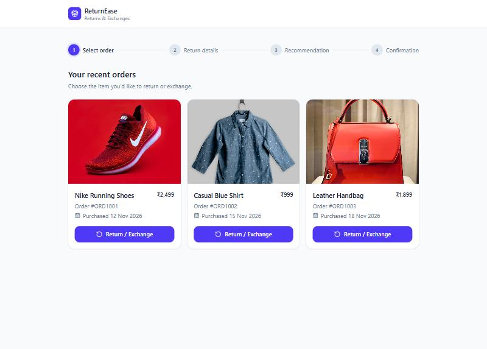
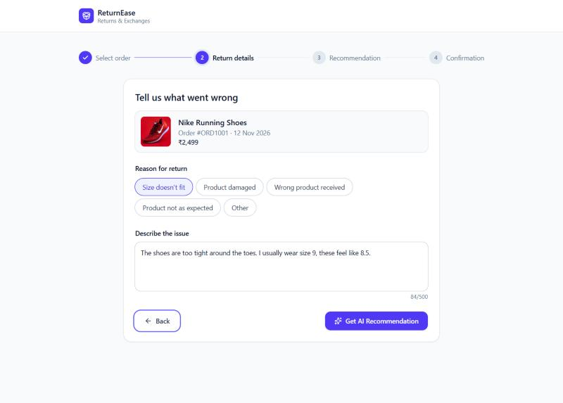
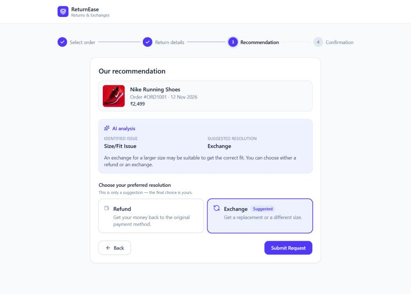
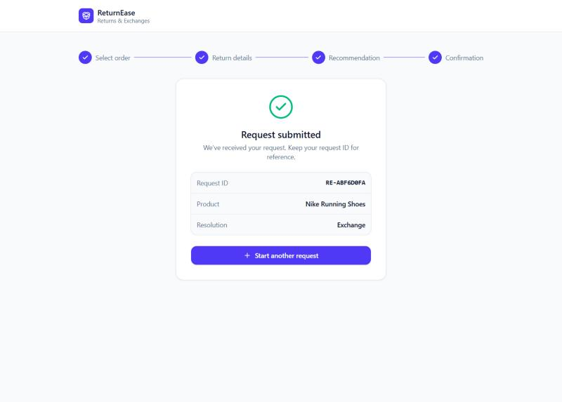

# ReturnEase – AI-Powered Returns & Exchanges

ReturnEase is a small MVP web app that lets online shoppers request a **return or exchange** without contacting customer support. The customer describes the problem, **Google Gemini** classifies the issue and suggests a resolution, and the customer makes the final choice. The request is saved in SQLite with a unique request ID.

> This is a demo MVP, not a production e-commerce platform. The orders are hardcoded sample data.

## Screenshots

| 1. Order selection | 2. Return details |
|---|---|
|  |  |
| **3. AI recommendation** | **4. Confirmation** |
|  |  |

## Features

- Four-step flow: select order → describe issue → AI recommendation → confirmation
- AI classifies the issue (e.g. *Size/Fit Issue*) and **suggests** Refund or Exchange. The customer always makes the final decision.
- Structured JSON output from Gemini, validated with Pydantic
- Rule-based fallback if the AI is unavailable (no key, timeout, overload, invalid output), so the customer can always finish
- Requests saved in SQLite with a server-generated ID (e.g. `RE-63877F68`)
- Loading and error states, input validation on frontend and backend
- Responsive layout for desktop and mobile

## Tech stack

| Layer | Technology |
|---|---|
| Frontend | React 19 + Vite, Tailwind CSS v4, Lucide icons |
| Backend | Python, FastAPI, Pydantic |
| Database | SQLite (Python's built-in `sqlite3`) |
| AI | Google Gemini via the official `google-genai` Python SDK |

## Project structure

```
ReturnEase/
├── backend/
│   ├── main.py             # FastAPI app and the 4 API routes
│   ├── models.py           # Pydantic request/response models
│   ├── ai_service.py       # Gemini call: prompt, structured output, validation
│   ├── recommendations.py  # Rule-based fallback recommendations
│   ├── database.py         # SQLite table, save and fetch requests
│   ├── sample_data.py      # 3 hardcoded demo orders
│   ├── requirements.txt
│   └── .env.example        # Copy to .env and add your Gemini key
├── frontend/
│   ├── src/
│   │   ├── App.jsx         # Flow state and screen navigation
│   │   ├── api.js          # All calls to the backend
│   │   ├── constants.js    # Return reasons, price/date formatting
│   │   ├── components/     # ProgressSteps, Button, ProductSummary, ErrorBanner
│   │   └── screens/        # The 4 screens
│   └── vite.config.js      # Tailwind plugin + /api proxy to the backend
└── docs/screenshots/
```

## How it works

```
React screen → App.jsx → api.js → Vite proxy (/api) → FastAPI route
                                                      ├── Pydantic validation
                                                      ├── ai_service.py → Gemini (fallback on failure)
                                                      └── database.py → SQLite
```

1. `GET /api/orders` loads the sample orders.
2. `POST /api/analyze-return` sends the product, reason and description to Gemini. Gemini must reply with JSON matching this schema:
   ```json
   {
     "issue_category": "Size/Fit Issue",
     "recommended_resolution": "Exchange",
     "explanation": "An exchange for a larger size may be suitable to get the correct fit."
   }
   ```
   The reply is checked against a Pydantic model. If the call fails or the output is invalid, a rule-based suggestion is returned instead (`"is_fallback": true`), and the UI says so.
3. The customer picks Refund or Exchange (no option is preselected).
4. `POST /api/return-requests` saves the request and returns a unique request ID.

**AI guardrails:** the AI only *suggests*. It is instructed not to invent return windows, eligibility rules, fees or timelines, and not to promise approval. The customer's text is treated as data, so instructions written inside it are ignored.

## Setup

### Prerequisites

- Python 3.10+
- Node.js 20+
- A Gemini API key from [Google AI Studio](https://aistudio.google.com/apikey) (free tier available)

### 1. Backend

```bash
cd backend
python -m venv venv

# Windows
venv\Scripts\python.exe -m pip install -r requirements.txt
# macOS / Linux
venv/bin/python -m pip install -r requirements.txt
```

Create `backend/.env` from the example and add your key:

```bash
cp .env.example .env    # Windows: copy .env.example .env
```

```
GEMINI_API_KEY=your-real-key
GEMINI_MODEL=gemini-3.5-flash-lite
```

Start the API (runs on http://localhost:8000):

```bash
# Windows
venv\Scripts\python.exe -m uvicorn main:app --reload --port 8000
# macOS / Linux
venv/bin/python -m uvicorn main:app --reload --port 8000
```

Interactive API docs: http://localhost:8000/docs

### 2. Frontend

In a second terminal:

```bash
cd frontend
npm install
npm run dev
```

Open http://localhost:5173.

> **Windows PowerShell tip:** if you see *"running scripts is disabled on this system"*, use `npm.cmd run dev` instead of `npm run dev`, and run Python via `venv\Scripts\python.exe` as shown above instead of activating the venv.

## API endpoints

| Method | Path | Description |
|---|---|---|
| GET | `/api/orders` | List the sample orders |
| POST | `/api/analyze-return` | Get an AI (or fallback) recommendation |
| POST | `/api/return-requests` | Save the customer's final request, returns the request ID |
| GET | `/api/return-requests/{request_id}` | Fetch a saved request |

## Configuration

| Variable | Description |
|---|---|
| `GEMINI_API_KEY` | Your Gemini API key (backend only, never sent to the browser) |
| `GEMINI_MODEL` | Gemini model name. Default: `gemini-3.5-flash-lite` |

The API key lives only in `backend/.env`, which is listed in `.gitignore`. The database file `backend/returnease.db` is created automatically on first run and is also ignored.

## Testing the flow

1. Pick a product and click **Return / Exchange**.
2. Choose a reason, write at least 10 characters, and click **Get AI Recommendation**.
3. Review the AI analysis, choose **Refund** or **Exchange**, and submit.
4. Note the request ID, then fetch it at `GET /api/return-requests/{request_id}` in the API docs.

To see the fallback, remove `GEMINI_API_KEY` from `.env` and restart the backend: Screen 3 will show a standard suggestion with a note that the AI is unavailable.

## Out of scope (by design)

No authentication, payments, courier integration or admin dashboard. This MVP focuses on the core customer journey.

## Credits

Product images from [Unsplash](https://unsplash.com) (free to use under the Unsplash License).
